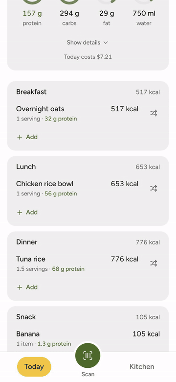

# Bitewise

Cheap meals that hit your macros, on repeat, with a swap when you're bored.

**Live:** [stapleapp.vercel.app](https://stapleapp.vercel.app). Tap **Try the demo**, no email needed.
On a phone, add it to your home screen and it opens like an app.



Full tour, including a real barcode scan on an iPhone:
[staple-demo-light-real-scan.mp4](design/videos/staple-demo-light-real-scan.mp4) ·
dark mode: [staple-demo-dark.mp4](design/videos/staple-demo-dark.mp4)

## Why

I live alone and cook for myself, so I repeat a few cheap meals that hit my protein.
Calorie trackers don't know what food costs. Meal planners make up recipes with ingredients
I don't have. None of the apps I tried let me swap one of *my* meals for another with the
same protein at the price I actually paid. So I built one.

## What it does

- **Today:** your meals against daily goals for calories, protein, carbs, fat and water,
  shown as progress rings, plus what the day costs.
- **Staple recipes:** your own meals, each showing calories, macros, cost and
  protein per dollar per serving.
- **"I'm tired of this" swap:** one tap on a meal brings up your other recipes as a card
  stack, best match first. Swipe right to swap, left to skip.
- **Barcode scanning:** scan a package with the phone camera, the nutrition comes from
  Open Food Facts, and you type what you paid.
- **Protein per dollar:** grams of protein per $1, on recipes, swap cards and the day.
- Light and dark mode, installable on iPhone and Android.

## Interesting decisions

- **Missing stays missing.** A food with no price shows "no price yet", never $0. If one
  ingredient has no sodium, the recipe's sodium is "—" and the screen names the food.
  A day adds up what it knows and says what's left out ("+ 1 food without protein").
  A number that looks right but quietly leaves something out is worse than no number.
- **The swap ranking works like a spreadsheet sort.** Sort by protein first, then by how
  many foods you'd need to buy, then by cost, then by what you've eaten lately. Each column
  is a coarse group (protein "within 15%", not the exact grams), so the later columns
  still get a say. It's a pure function in `lib/swap.ts` with its own tests.
- **Honest wording.** Until I track purchases, "foods you have" means foods you logged in
  the last 7 days. So the card says "Uses 3 foods you've had this week", never
  "in your kitchen".
- **A demo with no admin key.** Visitors can't get a login email, so "Try the demo" signs
  into one shared account on the server. It resets its own sample data as that user, so
  Row Level Security still applies and the demo can only ever touch its own rows.

## Design

- **Restrained palette.** White and near-black with one matcha accent, defined as OKLCH tokens in one file. A test checks every text and surface pair passes 4.5:1 contrast in light and dark mode.
- **Type that's easy to scan.** Figtree for everything, bold for titles and the big numbers, with tabular figures so numbers line up.
- **Motion with a purpose.** Press feedback, a carousel slide when you swap a meal, swipe-to-delete with Undo, and rings that fill on open. With Reduce Motion, things fade or change instantly instead. Before/after clips: [`design/ui/motion/`](design/ui/motion/).
- **Accessibility pass.** Visible focus rings, 44 px tap targets, screen-reader labels and announced errors, and designed empty, loading, error and offline states.

## How I built it with AI

I built it with Claude Code. It writes most of the code; I make the decisions, review
the work and read the code until I understand it.

- **Plan first.** Every feature starts as a written plan: database changes, files, tests,
  and the phone layout in words. I push back and change it before any code exists.
  There are 13 plans in [`plans/`](plans/), one feature at a time.
- **[`CLAUDE.md`](CLAUDE.md) is the spec.** It holds the database schema, formulas,
  rounding rules, colours with their contrast ratios, and my working rules, so every
  session builds toward the same app.
- **A code-reviewer subagent** ([`.claude/agents/code-reviewer.md`](.claude/agents/code-reviewer.md))
  reviews each change before it's committed. It never edits code, and it keeps its own
  notes so it doesn't raise things I already decided. It has done 43 reviews so far. Catches:
  - A package size of 0 made a food look free ([fix](https://github.com/danikcompeng/meal-cost-tracker/commit/599293a)).
  - Rounding errors that grew with every edit, "1,000" read as 1, and an app left open
    overnight logging breakfast to yesterday ([fix](https://github.com/danikcompeng/meal-cost-tracker/commit/8ca92ae)).
- **Tests:** 822 unit tests in 37 files cover the maths, validation, swap ranking and
  colour contrast. 3 Playwright tests run the main flows on an iPhone-sized screen.
- **Notes as I learn:** [`notes.md`](notes.md) has my debugging write-ups, design rules
  and lessons, for example connecting the Supabase MCP in read-only mode and checking
  that the database itself refuses a delete.

## Stack

Next.js (App Router) · TypeScript · Tailwind CSS + shadcn/ui · Framer Motion ·
Supabase (Postgres, Auth, Row Level Security) · Vitest · Playwright · Vercel

## Run it locally

```bash
npm install
npm run dev     # http://localhost:3000
```

You need a Supabase project. Run the SQL files in `supabase/migrations/` in order, then
put these in `.env.local`:

- `NEXT_PUBLIC_SUPABASE_URL`
- `NEXT_PUBLIC_SUPABASE_PUBLISHABLE_KEY`
- `DEMO_EMAIL`, `DEMO_PASSWORD` (optional: the "Try the demo" account. Without them the
  button is hidden.)

## Tests

```bash
npm test                          # unit tests (Vitest)
npx playwright install chromium   # once
npm run test:e2e                  # log a meal, build a recipe, swap a meal
npm run record:demo               # re-record the demo videos into design/videos/
```

The Playwright tests run against the live app and only log in with **Try the demo**.
Set `BASE_URL=http://localhost:3000` to test a local copy instead. To make MP4s,
`record:demo` needs ffmpeg (or point `FFMPEG_PATH` at one).
